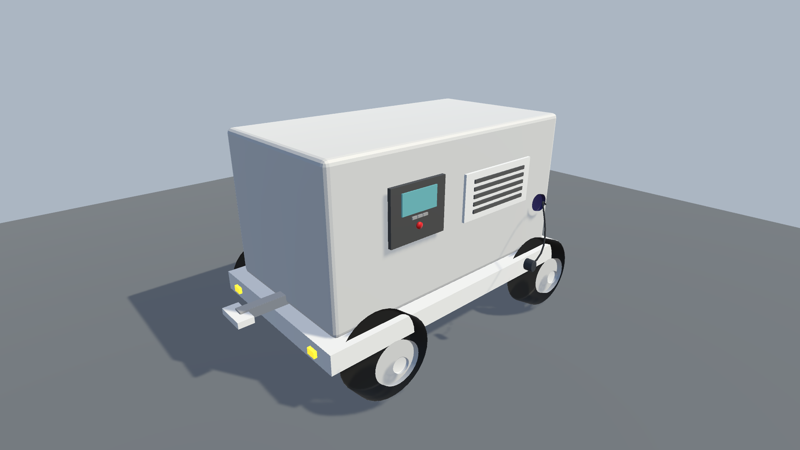

# Airport Ground Power Unit (GPU) — 3D Model

  

## Project Overview

A personal 3D modeling project featuring a stylized Airport Ground Power Unit (GPU), an industrial ground-support vehicle used at airports.

The model was created in Blender and imported into Unity for real-time visualization and presentation.

## Tools Used

- **Blender 4.3** — 3D modeling, geometry, bevels and materials
- **Unity 2022.3** — model import, scene setup, lighting and presentation
- **FBX** — asset export and transfer between applications

## Model Features

- Industrial equipment housing
- Four wheels with rims and hubs
- Chassis and towing attachment
- Ventilation grille
- LCD control panel and buttons
- Power socket and cable
- Front and rear lights

## Workflow

1. Created the 3D model in Blender.
2. Modeled individual mechanical components.
3. Applied basic materials and surface shading.
4. Exported the model as an FBX asset.
5. Imported the asset into Unity.
6. Configured the scene, camera, lighting and background.
7. Captured presentation images and a wireframe view.

## Project Gallery

- **Airport_GPU_Hero.png** — main presentation view
- **Airport_GPU_Back.png** — rear three-quarter view
- **Airport_GPU_Wireframe.png** — mesh visualization

## Project Goal

The goal of this project was to practice hard-surface modeling, building an industrial asset from individual components, and preparing a 3D model for presentation in a real-time game engine.

This is a personal learning and portfolio project.
